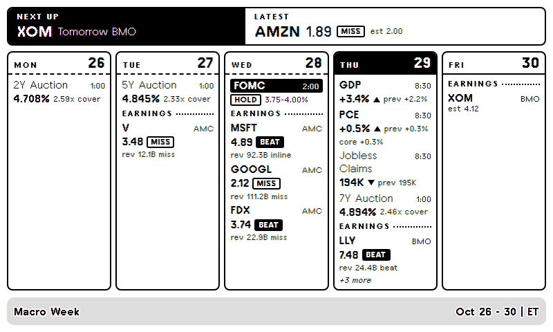
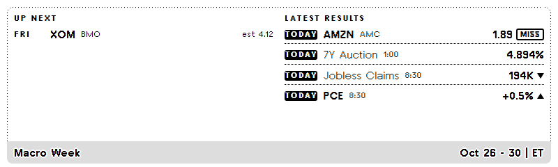
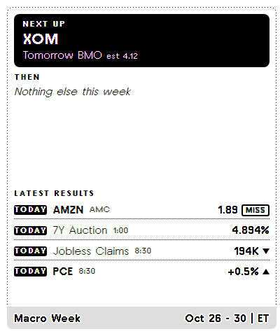
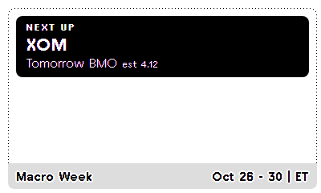

# Macro Week (TRMNL Recipe)

[](https://github.com/DmitriyRogo/macro-week-trmnl/actions/workflows/ci.yml)
[](https://github.com/DmitriyRogo/macro-week-trmnl/actions/workflows/uptime.yml)

This week's market-moving US events on your [TRMNL](https://trmnl.com) e-ink display, and how they turned out.



<sub>Live data, Thursday Oct 29 2026, rendered with TRMNL's `trmnlp` preview.</sub>

| Half horizontal | Half vertical | Quadrant |
| --- | --- | --- |
|  |  |  |

## What it shows

- **Macro releases** with ET release time: CPI, PPI, Jobs Report, GDP, PCE, Retail Sales, plus (optionally) JOLTS, Jobless Claims, UMich Sentiment, Housing Starts and the ISM PMIs. Once released: the actual number with an arrow against the prior reading (`+0.3% ▲ prev +0.2%`), and a second number underneath where it matters: **core CPI**, **core PCE**, the **unemployment rate**.
- **FOMC**: decision days (2:00 PM ET), marked **SEP** when new projections come out; once decided, **CUT / HOLD / HIKE** and the new target range. **Minutes** three weeks later.
- **Treasury auctions** of 2, 5, 7, 10, 20 and 30-year notes and bonds: the winning yield and bid-to-cover once auctioned.
- **Earnings** for one of four company groups (market leaders, mega-cap tech, big banks, Dow 30), tagged BMO / AMC, with the EPS estimate. Once reported: actual EPS with **BEAT / MISS / INLINE**, and revenue against its estimate.
- **Market holidays** and 1:00 PM early closes.

The screen shows the current week, Mon-Fri, so earlier days keep their results. Saturday recaps the week that just ended; Sunday previews the next one. All times are US Eastern. Users install it and it works: no API keys, no watchlist.

## How it works

```
FRED ──────────┐                              ┌─ TRMNL (user A's plugin) ─ device
Finnhub ───────┼─ server/ (Fly.io) ─ GET /week ┤
TreasuryDirect ┘   hourly + every 5 min on     └─ TRMNL (user B's plugin) ─ device
                   release mornings, cached
```

- **`server/`** (Node, no dependencies) fetches with one shared key per source: FRED's release calendar, Finnhub's whole-market earnings calendar (actual EPS and revenue included), TreasuryDirect's auction list, and, for releases already due this week, the FRED series holding each result. It adds the FOMC, ISM and holiday tables and builds one JSON week. Every user gets the same response (one variant per form setting), so upstream load doesn't grow with installs.
- On release days the server re-checks every 5 minutes until each result is in, instead of waiting for the hourly refresh. TRMNL polls every 15 minutes.
- **`src/`** is the TRMNL plugin. It polls `GET /week?scope=…&group=…` and only renders.

## Lessons from live data

Everything passed unit tests against mock data. Pointing it at the real APIs found five bugs that would have shipped:

1. **Every screen would have been blank.** The shared Liquid templates used `` / ``. The local Liquid engine accepted the whitespace-trimmed form; TRMNL's parser doesn't recognise the trimmed closing tag and swallows the rest of the layout. Found by rendering with TRMNL's own `trmnlp`; CI now renders every layout through it and fails on an empty one.
2. **Last month's CPI would have shown as this month's.** To tell whether a release has landed, the server checks when FRED published the newest value (`realtime_start`). FRED reports that date clamped to the requested window, which defaults to today, so every value looked brand new. The server now asks for a window starting the day before the release, and only a genuinely new value carries a date inside it.
3. **Busy earnings weeks would have lost companies.** Finnhub returns at most 1,500 rows per call and drops the rest without saying so. Earnings are now fetched one day at a time.
4. **Berkshire would never have appeared.** Finnhub's whole-market calendar lists it as `BRK.A`, never `BRK.B`.
5. **Housing Starts would have shown twice a month.** FRED lists a second date about a week after each release that never updates the number, so it would have sat on "awaiting data". Dates within 12 days of the previous one are dropped.

## Layouts

| Layout | Shows |
| --- | --- |
| Full | Top strip: **Next up** (inverted) and **Latest** result. Below: Mon-Fri columns with macro events, then an Earnings section with as many companies as fit ("+N more"). Today's header is inverted; past days have a dashed header rule. |
| Half horizontal | **Up next** (4) beside **Latest results** (4) |
| Half vertical | Big **Next up** block, then the following 5, then **Latest results** (4) |
| Quadrant | Big **Next up** block plus the following 3 |

1-bit safe: pure black and white, the device's pixel-font sizes (12 / 16 / 21 px), CSS-drawn arrows (pixel fonts may lack arrow glyphs), ASCII-only text. Headline releases are bold; BEAT and rate moves are filled chips, MISS is outlined, INLINE and holidays are dashed. A released event whose data hasn't reached FRED yet shows "awaiting data". The server estimates each column's height so a busy day never cuts off silently.

## Form fields (end users)

| Field | keyname | Options |
| --- | --- | --- |
| Releases | `release_scope` | **All tracked releases** (default) or **Headline only** (CPI, PPI, Jobs, GDP, PCE, Retail Sales). FOMC decisions always show. |
| Companies | `ticker_group` | **Market leaders** (default), **Mega cap tech**, **Big banks**, **Dow 30** |

## Server

### Run locally

Node 20+, no dependencies.

```sh
cd server
export FRED_API_KEY=...        # https://fredaccount.stlouisfed.org/apikeys (free)
export FINNHUB_API_KEY=...     # https://finnhub.io/dashboard
npm start                      # http://localhost:8080/week
npm test
npm run verify                 # checks the live APIs still match what the server assumes
```

| Env var | Default | Purpose |
| --- | --- | --- |
| `FRED_API_KEY` | required | FRED key |
| `FINNHUB_API_KEY` | required | Finnhub key (sent as a header, never logged) |
| `ACCESS_TOKEN` | unset | If set, `/week` requires `Authorization: Bearer <token>` |
| `PORT` | `8080` | |
| `REFRESH_MINUTES` | `60` | Full upstream refresh interval |
| `FAST_MINUTES` | `5` | Re-check interval on release days, until each result is in |
| `MAX_STALE_HOURS` | `36` | After this long without a successful fetch, that section hides |

Endpoints:
- `GET /week?scope=all_tracked_releases|headline_only&group=market_leaders|mega_cap_tech|big_banks|dow_30`
- `GET /healthz`: minutes since each source refreshed, plus `warnings` when a hand-kept table in `config.js` runs out within 60 days.

A failed fetch keeps the last good data. On a cold start the first request waits for the initial fetch.

### Deploy

Pushes to `main` run the tests, lint and render the plugin with `trmnlp`, then deploy to Fly.io (`.github/workflows/ci.yml`). This needs a `FLY_API_TOKEN` repository secret:

```sh
fly tokens create deploy -a macro-week -x 8760h | gh secret set FLY_API_TOKEN
```

Manual deploy: `cd server && fly deploy`. First time: `fly launch --no-deploy`, then `fly secrets set FRED_API_KEY=... FINNHUB_API_KEY=...`. `fly.toml` keeps one machine running, because the cache is in memory.

`.github/workflows/uptime.yml` checks `/healthz` every 30 minutes and fails (GitHub emails you) if the server is down, a source is over 3 hours stale, or a table needs updating.

**Access token:** `ACCESS_TOKEN` + `polling_headers: Authorization=Bearer <token>` stops casual scraping, but anyone who installs a public Recipe may be able to see its polling settings, so treat it as a speed bump, not security.

### Data licensing

The server shows Finnhub data to every user with one key; the Finnhub plan used allows this. FRED release dates and series, TreasuryDirect auction results and the Fed's calendar are public. ISM index values are licensed by ISM, so ISM days show the date only.

## Plugin development

```sh
gem install trmnl_preview      # needs Ruby 4.0+
trmnlp serve                   # previews src/ against polling_url at http://127.0.0.1:4567
trmnlp lint                    # TRMNL's markup checks
TRMNL_API_KEY=user_... trmnlp push --force
```

`trmnlp push` rewrites `src/settings.yml` from TRMNL's copy and drops `recipe_overview`; keep the committed file.

## Files

```
src/settings.yml           plugin settings, polling URL, form fields
src/shared.liquid          CSS + shared templates (mw_ev, mw_row, mw_next, mw_title)
src/full.liquid, half_horizontal.liquid, half_vertical.liquid, quadrant.liquid
server/src/config.js       ← everything that needs periodic updates (below)
server/src/build.js        builds the week JSON (pure, unit-tested)
server/src/results.js      formats results: macro vs prior, FOMC decision, EPS + revenue, auction yield
server/src/sources.js      FRED, Finnhub, TreasuryDirect fetchers
server/src/index.js        HTTP server, refresh schedule, cache
server/test/               node:test suites
server/scripts/verify.mjs  checks the live FRED / Finnhub APIs
.github/                   CI, deploy, uptime check
docs/                      screenshots, original build spec
```

## Maintenance (all in `server/src/config.js`)

`/healthz` and the uptime check warn 60 days before the FOMC or holiday table runs out.

| What | When | How |
| --- | --- | --- |
| **FOMC dates** | Yearly, and after each meeting | From <https://federalreserve.gov/monetarypolicy/fomccalendars.htm>, add each meeting's **second day** to `FOMC` with `sep: true` for asterisked meetings. If the Fed moves a minutes release off the usual three weeks, add it to `FOMC_MINUTES_OVERRIDES`. |
| **Market holidays** | Yearly | From <https://www.nyse.com/markets/hours-calendars>, update `MARKET_CLOSED` and `EARLY_CLOSE`. |
| **Ticker groups** | Quarterly | Edit `TICKER_GROUPS` (priority order). Check Dow 30 membership. |
| **Releases** | As needed | Add a FRED `release_id` to `RELEASES` with the `series` holding its headline number, a `format` (`mom`, `pct`, `change_k`, `level`) and optionally an `extra` second number. Re-verify release times yearly. |

### Release allowlist

| release_id | FRED name | Label | ET | Tier | Result series | Second number |
| --- | --- | --- | --- | --- | --- | --- |
| 10 | Consumer Price Index | CPI | 8:30 | Headline | CPIAUCSL, % m/m | core (CPILFESL) |
| 46 | Producer Price Index | PPI | 8:30 | Headline | PPIFIS, % m/m | |
| 50 | Employment Situation | Jobs Report | 8:30 | Headline | PAYEMS, change K | unemployment (UNRATE) |
| 53 | Gross Domestic Product | GDP | 8:30 | Headline | A191RL1Q225SBEA, % q/q ann. | |
| 54 | Personal Income and Outlays | PCE | 8:30 | Headline | PCEPI, % m/m | core (PCEPILFE) |
| 9 | Advance Monthly Sales for Retail and Food Services | Retail Sales | 8:30 | Headline | RSAFS, % m/m | |
| 192 | Job Openings and Labor Turnover Survey | JOLTS | 10:00 | Tracked | JTSJOL, M | |
| 180 | Unemployment Insurance Weekly Claims Report | Jobless Claims | 8:30 | Tracked | ICSA, K | |
| 91 | Surveys of Consumers | UMich Sentiment | 10:00 | Tracked | UMCSENT, index | |
| 27 | New Residential Construction | Housing Starts | 8:30 | Tracked | HOUST, M ann. rate | |

FOMC results use `DFEDTARU` / `DFEDTARL`, which FRED posts the day after the decision.

## Known limits

- **No consensus forecasts.** Macro results compare with the prior reading; Finnhub's economic calendar (which has forecasts) needs a higher plan.
- FRED can take hours to post a release (UMich sometimes days); the screen shows "awaiting data" until it does.
- ISM dates follow the 1st / 3rd business-day rule; ISM occasionally shifts one.
- Font sizes are fixed for the 800×480 screen, so text doesn't scale up on larger TRMNL devices.

## License

[MIT](LICENSE)
